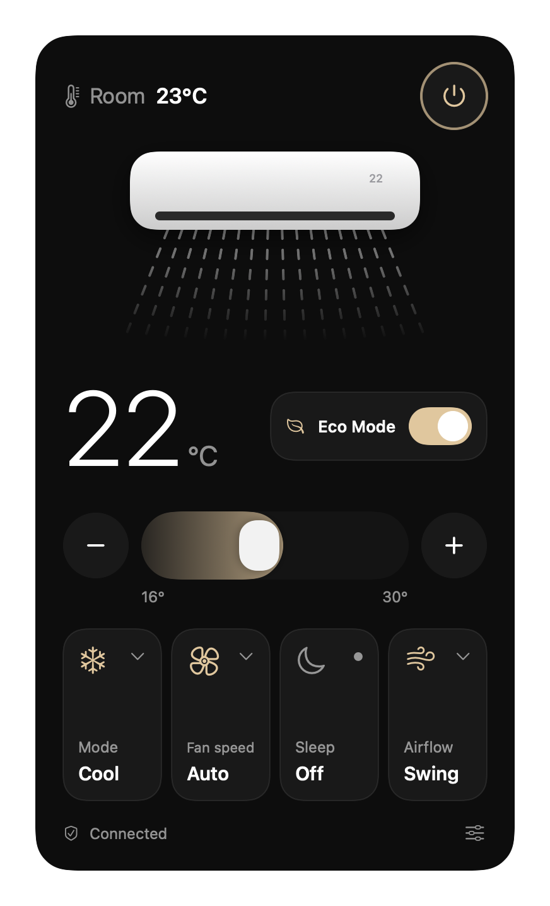
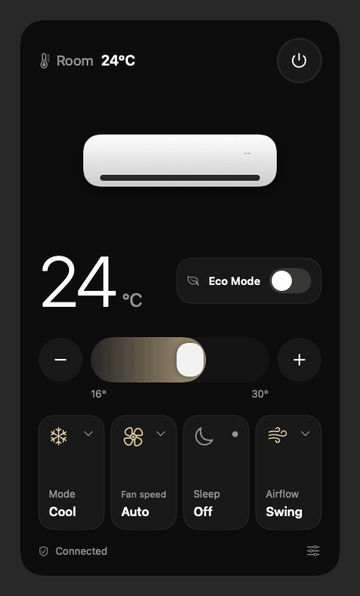

<div align="center">

# AC for Mac

**Your Gree air conditioner, one click away in the macOS menu bar.**

No remote to find. No cloud account. No Gree+ app. Just your Mac talking to your AC over the local network.




<br><br>



<sub>Animated demo rendered from the real interface with demo data.</sub>

</div>

## What you get

| | |
|---|---|
| **Power and temperature** | Big target temperature, pill slider and ± buttons (16–30 °C) |
| **Room temperature** | Read from the unit's own sensor |
| **Mode** | Auto, Cool, Dry, Fan, Heat |
| **Fan speed** | Auto, Low, Medium, High |
| **Sleep, Eco** | One-tap toggles |
| **Airflow** | Vertical flap: swing, or fixed at 5 positions |
| **More controls** | Turbo, Quiet, display light, Fresh air, Health, X-Fan, left/right swing (behind the sliders icon) |
| **Hover hints** | Hover any button and the footer explains what it does |
| **Menu bar** | Shows the target temperature while the AC is on. Right-click for *Launch at Login* and *Quit* |

It is a native SwiftUI app with zero third-party dependencies and no network traffic outside your home network.

## Install

### Option 1: download (no Xcode needed)

1. Download `AC-mac.zip` from the [latest release](https://github.com/jankutschera/gree-menubar/releases/latest) and unzip it.
2. Drag `AC.app` into your **Applications** folder and open it.
3. macOS will say it can't verify the app, because it isn't notarized by Apple. Allow it once:
   - open **System Settings → Privacy & Security**, scroll down and click **Open Anyway**, or
   - run `xattr -dr com.apple.quarantine /Applications/AC.app` in Terminal, then open it again.
4. Allow **Local Network** access when asked, otherwise macOS blocks the connection to your AC.

The app is a universal build (Apple Silicon and Intel) for macOS 14 or newer. It is open source, so you can read exactly what it does.

### Option 2: build from source

You need the Xcode command line tools (`xcode-select --install`).

```sh
git clone https://github.com/jankutschera/gree-menubar.git
cd gree-menubar
./build.sh
cp -R build/AC.app /Applications/
open /Applications/AC.app
```

Your AC must be on the same Wi-Fi as your Mac. To start the app at login, right-click the menu bar icon and choose **Launch at Login**.

## Troubleshooting

| Symptom | Try this |
|---|---|
| "AC not found on the network" | Check System Settings → Privacy & Security → Local Network → enable AC. Make sure Mac and AC are on the same network (guest Wi-Fi and VLANs often block discovery). |
| Discovery still fails | Skip it with the unit's IP: `GREE_IP=192.168.x.x /Applications/AC.app/Contents/MacOS/AC` |
| Some buttons do nothing | Not every unit supports every feature (Eco, Fresh air, X-Fan, horizontal swing, Health). The AC may simply ignore features it doesn't have. |
| Your unit has no local control | A few Gree units expose no local UDP service. They can't work with this app. |

Debug helpers, handy for bug reports:

```sh
/Applications/AC.app/Contents/MacOS/AC --status    # print the live state as the AC reports it
/Applications/AC.app/Contents/MacOS/AC --status --set SetTem=23   # send one command, then read back
AC_DEMO=1 /Applications/AC.app/Contents/MacOS/AC --snapshot a.png # render the panel with demo data
```

## How it works

Gree units speak a small JSON-over-UDP protocol on port 7000:

1. **scan**: broadcast `{"t":"scan"}`, the AC answers with its MAC address and firmware.
2. **bind**: ask for a device key. This is the step where newer firmware needs **AES-128-GCM** instead of the older AES-ECB.
3. **status / cmd**: read or write fields such as `Pow`, `Mod`, `SetTem`, `WdSpd`, `SwUpDn`.

The AC doesn't push changes, so the app polls every 10 seconds and whenever you open the panel. The room temperature is reported with a +40 offset, which the app removes.

The code is small on purpose:

| File | Job |
|---|---|
| `GreeClient.swift` | UDP transport, scan, bind, encryption, status and commands |
| `ACModel.swift` | Observable state, polling, optimistic updates |
| `ContentView.swift` | The panel: hero, slider, tiles, hover hints |
| `ACApp.swift` | Status item, popover, right-click menu, CLI helpers |

## Tested on

| Model | Firmware | Result |
|---|---|---|
| GWH12AWBXB-K6DNA3F | V3.4.M | Status and temperature control verified. The other controls use the same command path. |

Got a different Gree model? Please open an issue with the output of `--status` and tell us which buttons work. That's the fastest way to grow this list.

## Limits

- Whole degrees only (no 0.5 °C steps).
- Fan speeds are limited to Auto/Low/Medium/High, which is safe on every model.
- One AC per Mac for now.

## Credits

The protocol was mapped by the community. This app builds on
[tomikaa87/gree-remote](https://github.com/tomikaa87/gree-remote),
[greeclimate](https://pypi.org/project/greeclimate/) and
[gree-ac-mcp](https://mcpservers.org/servers/marcinn2/gree-ac-mcp).

Not affiliated with Gree. MIT licensed, see [LICENSE](LICENSE).
